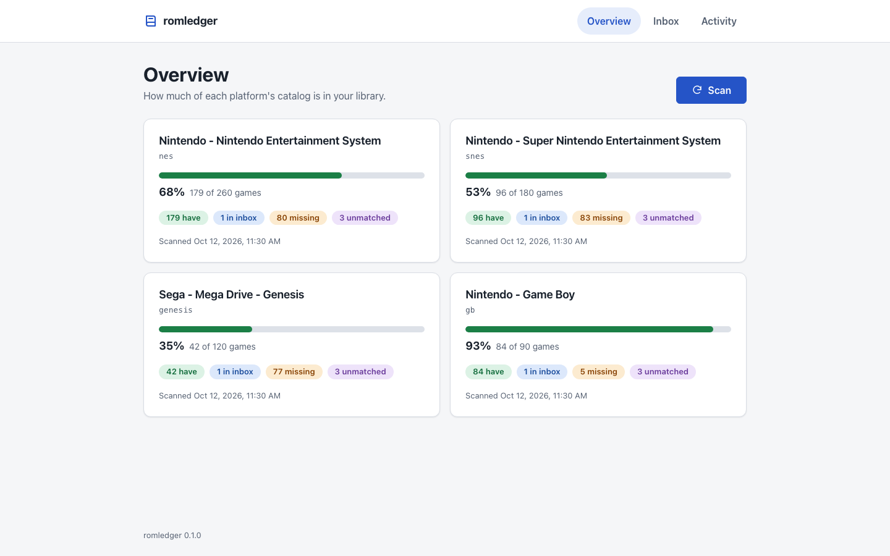

# romledger

Track which retro games you have and which are missing, verified against No-Intro and Redump DATs.

## Status

Works today:

- Validate a config file (`romledger config`)
- Download No-Intro and Redump DATs (`romledger dats update`)
- Match your library and inboxes to the DATs (`romledger scan`)
- Show progress per platform (`romledger status`)
- List missing games, with Vimm's Lair search links (`romledger missing nes --links`)
- Import from the inboxes into a RomM layout (`romledger import`)
- Browse progress, missing games and the inbox, and upload files, in a local dashboard (`romledger serve`)
- Download missing games from CoolROM and the Internet Archive (`romledger fetch`)
- Check that the supported sites and the igir pin still match (`romledger canary`; runs weekly in CI)

Vimm's Lair is manual; see [docs/sources.md](docs/sources.md).

<picture>
  <source media="(prefers-color-scheme: dark)" srcset="docs/images/overview-desktop-dark.png">
  
</picture>

## How it fits

- [igir](https://igir.io) matches files to DATs and moves them into place.
- [RomM](https://romm.app) is the library, play, and metadata layer.
- romledger decides what you have and what is missing.

## Install

Requires [uv](https://docs.astral.sh/uv/), Python 3.11+ and Node.js 22.22+ (romledger runs
[igir](https://igir.io) through `npx`).

```sh
uv tool install git+ssh://git@github.com/kjiwa/romledger
```

## Configure

Create `~/.config/romledger/config.toml`:

```toml
[library]
roms = "/mnt/roms/roms"
inboxes = ["/mnt/roms/inbox"]

[platforms.nes]
```

Both directories must exist. Platform names are RomM slugs, the folder names RomM uses, such as
`nes` and `snes`; the known ones are listed in `src/romledger/platforms.toml`. `dat` is filled in
for known platforms.

Check it, then fetch DATs and scan:

```sh
romledger config
romledger dats update
romledger scan
romledger status
romledger serve --open
```

See [docs/setup.md](docs/setup.md) for all options,
[docs/sources.md](docs/sources.md) for download sources and
[docs/troubleshooting.md](docs/troubleshooting.md) for error messages.
