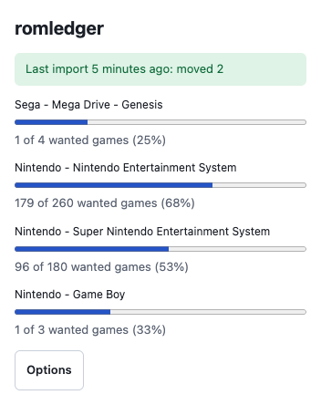

# Browser extension

The extension marks games on Vimm's Lair, CoolROM and the Internet Archive as in your library, in
your inbox, missing or not wanted, so you can browse and pick what to download. It never clicks or
downloads anything.

<picture>
  <source media="(prefers-color-scheme: dark)" srcset="images/extension-popup-dark.png">
  
</picture>

## Install

The extension is not in any browser store. Download `romledger-extension-<version>.zip` from the
[latest release](https://github.com/kjiwa/romledger/releases/latest) and unzip it. A source
checkout works too: use its `extension` folder.

- Chrome and other Chromium browsers: open `chrome://extensions`, turn on Developer mode, choose
  Load unpacked, and select the unzipped folder.
- Firefox 142 or later: open `about:debugging#/runtime/this-firefox`, choose Load Temporary
  Add-on, and select `manifest.json` in the unzipped folder. Firefox removes a temporary add-on
  when it closes, so repeat this after each restart. Firefox support is checked with
  `addons-linter` only; it is untested in a real Firefox.

## Connect it to romledger

1. Run `romledger serve` and keep the link it prints.
2. Open the extension's options. Enter the service URL (the field starts as `http://127.0.0.1:8730`, for a service on this
   machine) and the token (the part after `?token=` in the link).
3. Choose Save and test, then allow the browser to reach that address. The page reports the
   number of configured platforms.

The URL and token stay in this browser. The extension sends the SHA-1 hashes and titles it finds
on a page only to that address.

## What it shows

| Site | Page | What you see |
| --- | --- | --- |
| Vimm's Lair | A game (`/vault/<id>`) | A box with the state of each disc or file, matched by SHA-1 and then by title. |
| Vimm's Lair | A platform list | A badge after every game, matched by title. |
| CoolROM | A game or a platform listing | A badge by title. |
| Internet Archive | An item that you set as a platform's `archive_item` | The platform's progress. |

| Badge | Meaning |
| --- | --- |
| In library | The library has the game. |
| In inbox | The game is in an inbox and `import` has not filed it. |
| Missing | The DAT lists the game, you want it, and you do not have it. |
| Not wanted | The DAT lists it, but the platform's regions and languages exclude it. |
| Not scanned | The platform has no scan yet. Run `romledger scan`. |
| Not in any DAT | No DAT for a configured platform lists it. |

A badge that says `(approximate)` was matched by title. On Vimm's Lair lists the row's region
flags narrow the match; when several games still fit, the badge shows the best state among them.
Check the region and version before you rely on it. Platforms that are not in your config get no badges.

Vimm's Lair offers some GameCube games in extra formats (`ciso`, `nkit`, `rvz`). Only the
default ISO matches a Redump DAT, so download that one.

The toolbar popup lists every platform's progress. If it says the page layout was not recognized,
the site changed; see [troubleshooting.md](troubleshooting.md).
